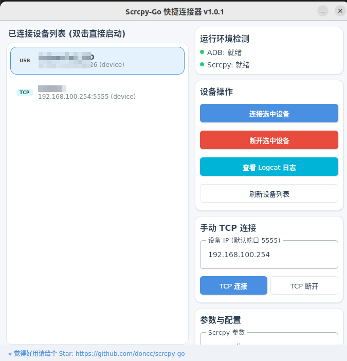
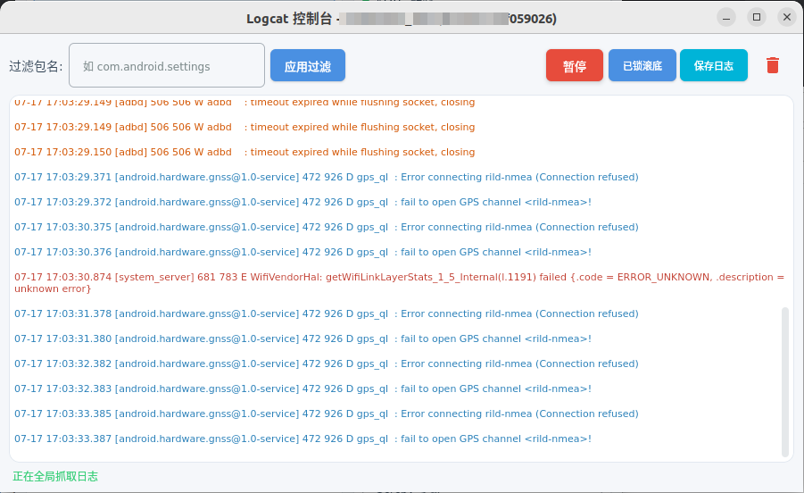

# scrcpy-go

[](https://github.com)

一个为 `scrcpy` 打造的轻量级图形化快捷连接与设备管理工具。它能够帮助你摆脱命令行，快速完成 Android 设备的有线/无线（TCP/IP）投屏连接、自定义参数配置，并内置了实时的 Logcat 日志抓取与过滤工具。

## 📸 界面预览

| 主界面 / 连接管理 | 日志控制台 |
| :---: | :---: |
|  |  |

## 🌟 主要功能

- **环境自动检测**：启动时自动寻找同级目录或系统环境变量中的 `adb` 和 `scrcpy` 路径。
- **设备图形化管理**：
  - 自动刷新并展示当前所有已连接的设备（有线 USB / 无线 TCP）。
  - 双击设备列表项直接启动 `scrcpy` 投屏。
  - 支持快捷断开指定设备的投屏进程。
- **无线 TCP 连接**：支持输入设备 IP 地址（默认 5555 端口）快捷进行网络连接（`adb connect` / `adb disconnect`）。
- **自定义投屏参数**：支持自定义输入 `scrcpy` 启动参数（如默认附带的 `--no-audio` 屏蔽音频投屏等）。
- **内置 Logcat 日志控制台**：
  - 流式实时抓取并展示指定设备的 `logcat` 日志。
  - 支持输入**应用包名进行过滤**（自动轮询获取 PID 并实现精确定向过滤）。
  - 根据日志级别（V/D/I/W/E/F）进行**颜色高亮染色**。
  - 限制最大缓冲区为 3000 行，避免超长日志导致界面卡死。
  - 支持一键清空日志与一键导出/保存日志为 `.log` 文件。
- **桌面快捷方式集成**：在 Linux 系统中支持一键生成桌面的 `.desktop` 快捷方式并自动注册到系统的应用菜单中。

## 📦 构建环境要求

在本地自行编译构建程序之前，请确保您的系统中已安装：

- **JDK 21**（或更高版本）

## 🚀 本地编译打包 (绿色免安装版)

你可以根据当前运行的操作系统，在项目根目录下通过相应的 Gradle 指令编译出专属的绿色免安装压缩包：

### 1. 编译指令

* **Windows 平台**（打开 PowerShell 或 CMD）：
  ```cmd
  .\gradlew.bat packageZip
  ```
* **Linux 平台**：
  ```bash
  ./gradlew packageZip
  ```
* **macOS 平台**：
  ```bash
  ./gradlew packageZip
  ```

### 2. 构建产物

编译完成后，构建生成的压缩包将被存放在项目根目录下的 **`build/distributions/`** 文件夹中。

---

## 💻 解压与运行说明

### 🏁 Windows 平台
1. 获取编译生成的压缩包（例如 `scrcpy-go-windows-x64-v<version>.zip`）。
2. 将压缩包解压。
3. 双击解压目录根路径下的 **`scrcpy-go/scrcpy-go.exe`** 即可启动。

### 🐧 Linux 平台
1. 获取编译生成的压缩包（例如 `scrcpy-go-linux-x64-v<version>.zip`）。
2. 将压缩包解压。
3. 打开终端，切换至解压目录，运行以下指令启动：
   ```bash
   ./scrcpy-go/bin/scrcpy-go
   ```

### 🍎 macOS 平台 (Intel / Apple Silicon M系列)
1. 获取编译生成的压缩包（例如 `scrcpy-go-macOS-aarch64-v<version>.zip` 或 `scrcpy-go-macOS-x64-v<version>.zip`）。
2. 将压缩包解压，即可直接得到 **`scrcpy-go.app`** 应用程序包。
3. 建议将 `scrcpy-go.app` 拖入系统的 **`/Applications` (应用程序)** 文件夹中，然后双击运行。
4. **安全提示（针对首次打开警告）**：
   由于该应用为本地自行编译且未经 Apple 开发者签名，首次打开时系统可能会提示“无法打开 scrcpy-go，因为 Apple 无法检查其是否包含恶意软件”或类似警告。你可以通过以下任一方式解决：
   * **方式一（推荐）**：打开 macOS 的“系统设置 -> 隐私与安全性”，滑动到页面下方，找到关于 `scrcpy-go` 被阻止的提示，点击 **“仍要打开”** 并输入锁屏密码确认即可。
   * **方式二（命令行移除隔离标记）**：打开终端，执行以下指令清除应用包的隔离属性（以拖入 Applications 目录为例）：
     ```bash
     xattr -cr /Applications/scrcpy-go.app
     ```
     执行后即可像普通软件一样直接双击打开运行。

---

## 📄 开源协议

本项目采用 [MIT](LICENSE) 协议开源。
